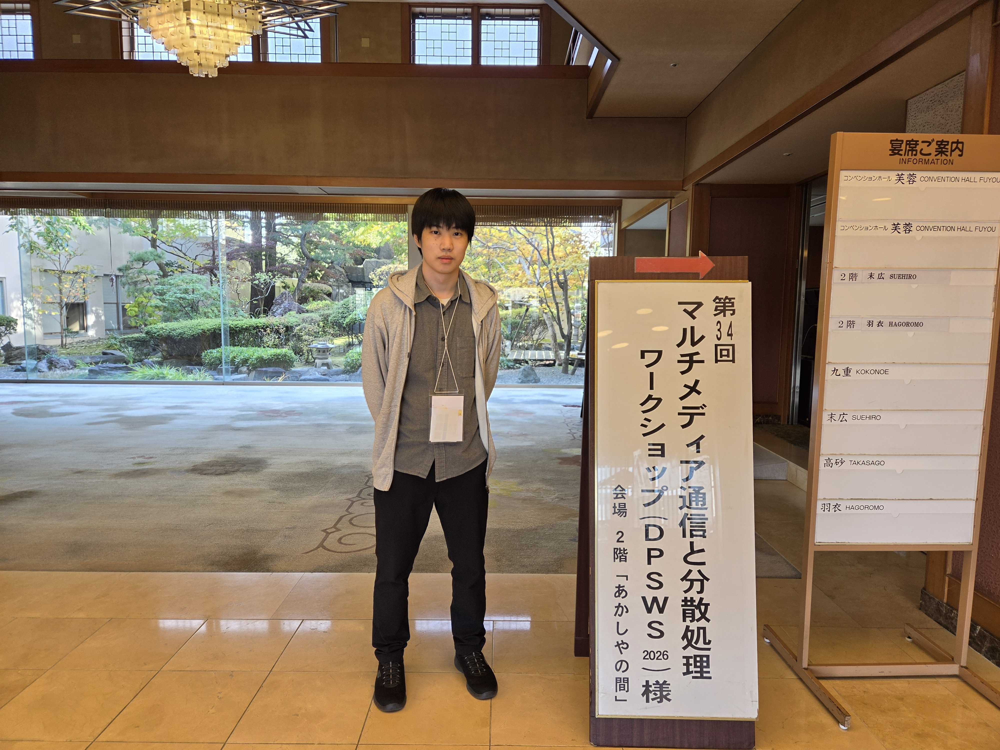
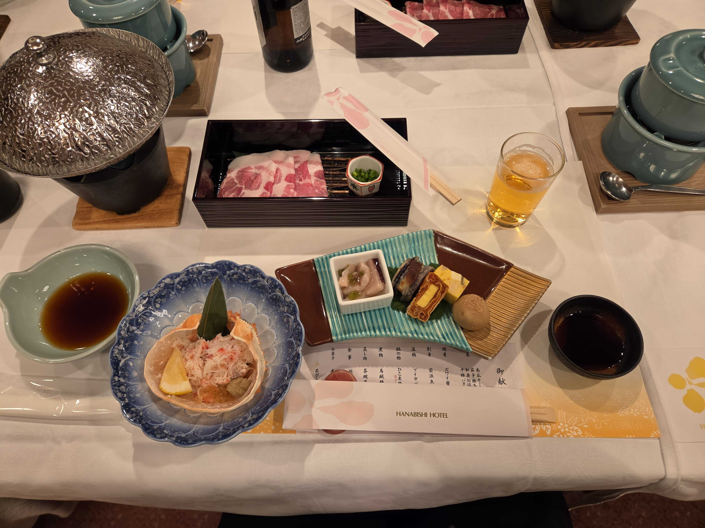
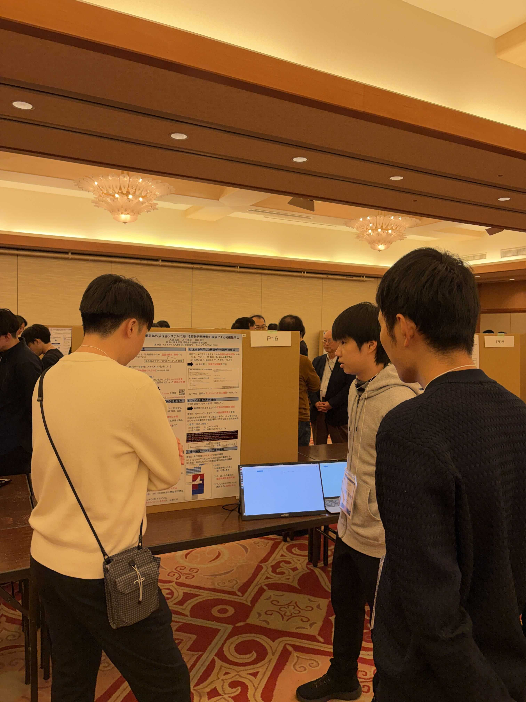
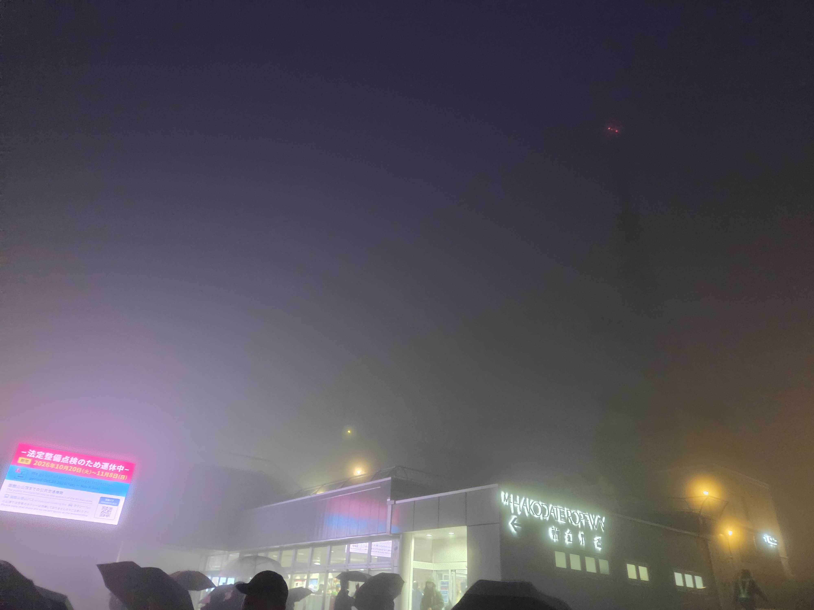
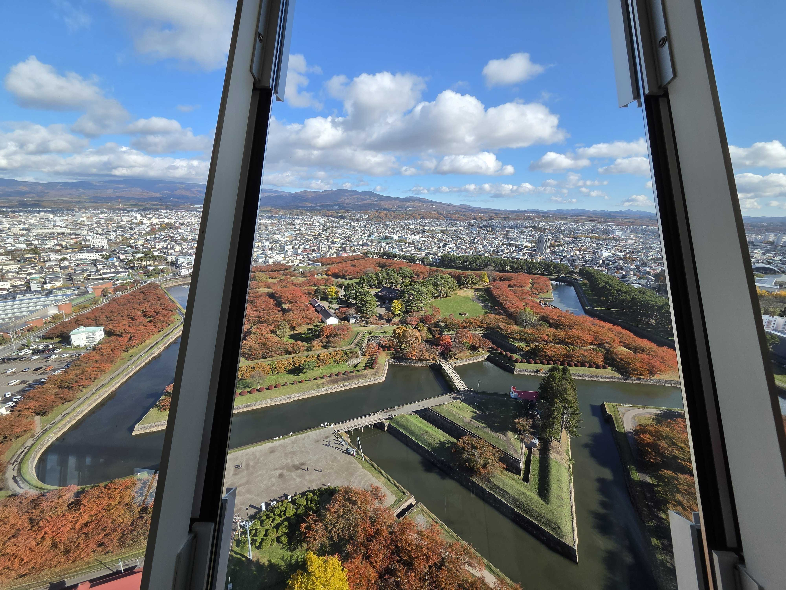

+++
date = '2026-11-10T15:46:51+09:00'
draft = false
title = 'DPSWS2026 に参加してきました'
showAuthor = true
authors = ['otsuki']
+++

こんにちは，M2の大槻です．
11/4(水)〜11/6(金) に開催されていた第34回マルチメディア通信と分散処理ワークショップ (DPSWS2026) に参加してきました．

<!-- more -->

今回の DPSWS2026 は，北海道函館の[花びしホテル](https://www.hanabishihotel.com/)で開催されました．

函館までは，岡山空港から羽田空港を経由して函館空港という旅順です．
飛行機を乗り継いでの移動は初めてだったので緊張しましたが，無事辿り着けました．

初日の口頭発表の後が終わると，早速夜ご飯でした．
夜ご飯は，函館の海鮮がメインの料理でした．

夜ご飯の後には懇親会があり，お酒を飲みながら学生や先生方と議論や雑談をする良い機会になりました．
函館の酒造が手掛けている地酒なども出てきてとても楽しい懇親会でした．

2日目にはポスターセッションがあり，私はここで発表してきました．
タイトルは「自動証跡作成保存システムにおける証跡活用機能の実現による利便性向上」です．
今まで実現してきた証跡作成，保存の機能に加えて，収集した証跡を活用する機能について紹介する内容となっています．

初めてのポスター発表でしたが，参加者の皆様からの様々な意見をいただき，非常に参考になりました．

このポスターセッションの後には，アウトドアセッションで函館山に行ったのですが…，この日は雨が降っており霧がかかっており，有名な函館の夜景は見れませんでした．
しかし，これはこれで綺麗な景色でした．

最終日にも昼ごろまでセッションや表彰式がありました．

セッションの後には，五稜郭に行ってきました．
写真は五稜郭タワーの展望台からの五稜郭です．ちょうど紅葉の季節でとても綺麗でした．

発表に関する議論もでき，函館を楽しむこともできてとても良い経験になりました！
