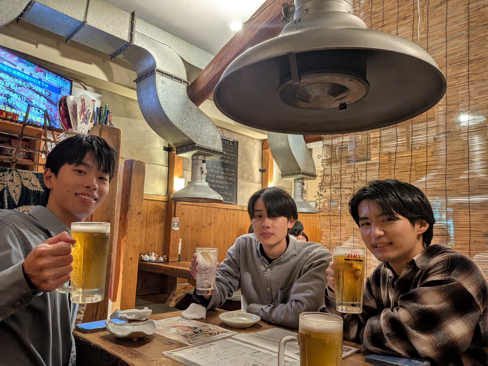

+++
date = '2026-11-26T17:52:33+09:00'
draft = false
title = '2026年度特別研究中間発表会'
showAuthor = true
authors = ['ikeda-r']
+++

こんにちは，B4の池田です!

11月18日に2026年度特別研究中間発表会が開催されました！
これは，B4が特別研究の中間結果を発表するイベントです．
B4としての阿保，池田，中畑，そして濱崎が参加しました．

初めての研究室外部での発表のため，B4一同，緊張した状態で本番に臨みました．
そんな緊張の中，発表した結果としては，
大きなトラブルはなく発表できたが，質疑応答が思うように対応できず，
悔しさが残るというものでした...．
想定外の質問や，質問の意図をすぐに理解できない場面があり，
対応力に課題を感じました．
今回の中間発表から得た課題を踏まえて，今後の発表に活かそうと思います!

{{< carousel images="{featured-abo-n-presen.png,ikeda-r-presen.png,nakahata-presen.png,hamazaki-presen.png}" >}}

中間発表の終了後はB4で飲み会をしました!
飲み会の場所は[あぶり酒家 ○△□ ](https://tabelog.com/okayama/A3301/A330101/33000668/dtlphotolst/smp2/)という名前の居酒屋です．
この居酒屋は濱崎くんのアルバイト先で，
本人いわく「料理がとても美味しい」とのことだったため，この居酒屋に決定しました！

実際に提供された料理はどれも絶品で， 濱崎くんが上げたハードルを軽々と超えてきました．
中でも特に美味しかったのは，「ガラエビの唐揚げ」です．
これは，シンプルにガラエビを揚げた一品です．
エビの風味が丁度良く口に広がり，揚げ物のおつまみという枠ではトップクラスに位置する料理でした．

{{< carousel images="{shrimp.jpg,kakuni.jpg,corn.jpg}" >}}

飲み会では，中間発表の本番での出来事や，そこに至るまでの大変だったエピソードなどで盛り上がり，
とても楽しい時間を過ごしました．

{{< carousel images="{nakahata-listen-sound-of-tomato-juice.jpg,nakahata-gorogoro.jpg,nakahata-berobero.jpg,nakahata-kurayami.jpg}" >}}

今回の特別研究中間発表会で得た課題をしっかりと活かし，今後の卒論執筆に励みたいと思います！
また，今回利用した居酒屋は料理が本当に美味しいので，機会があればぜひ足を運んでみてください！
